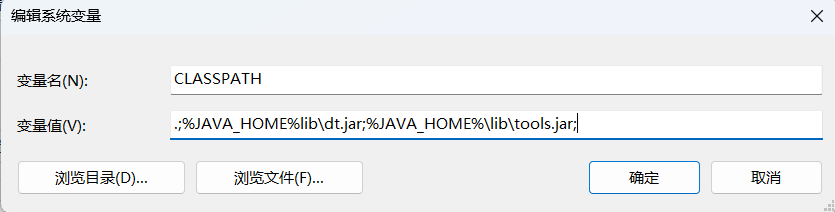
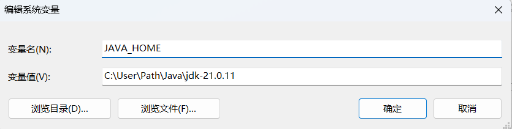
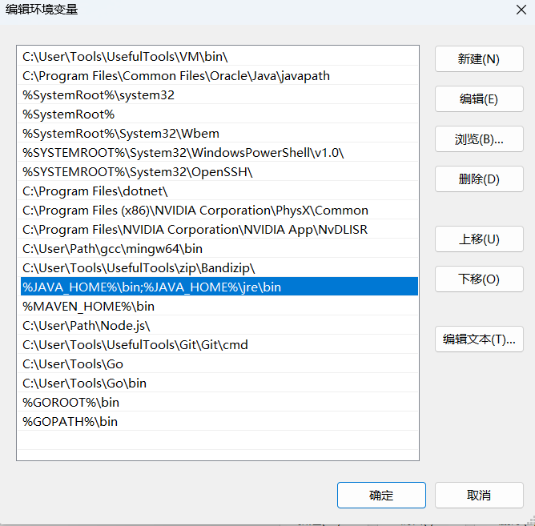
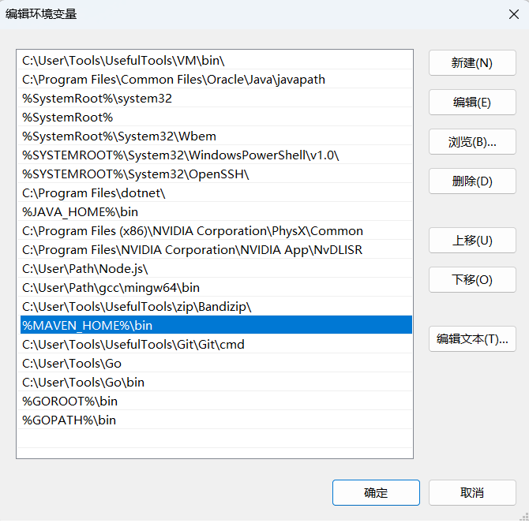
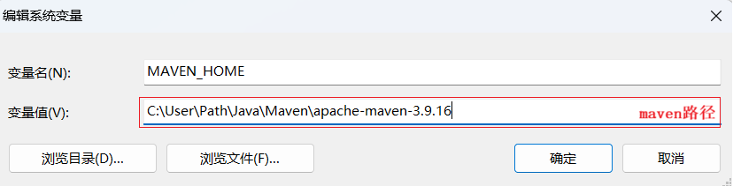
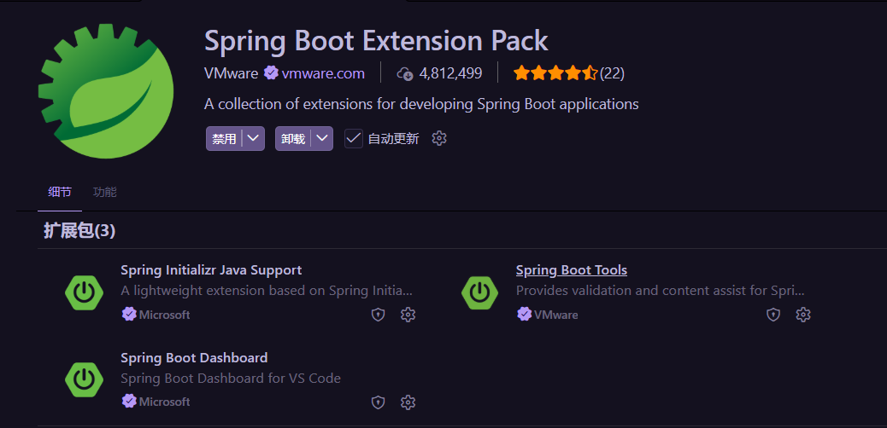
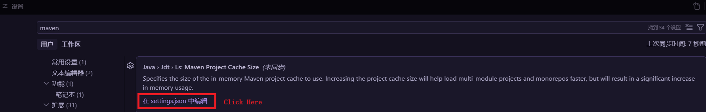
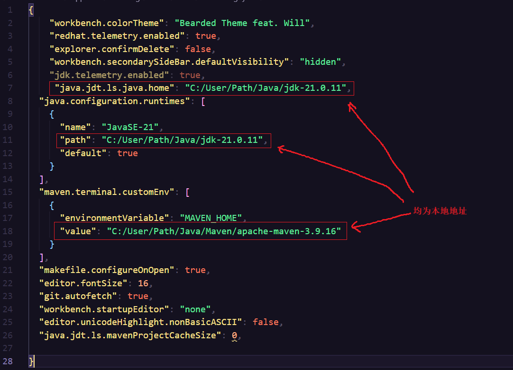
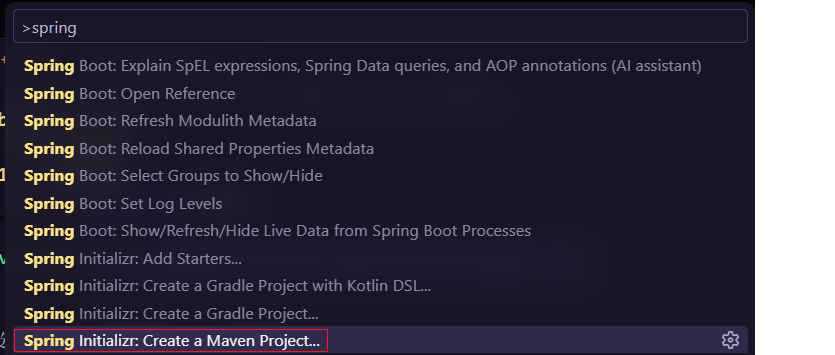

# TableTinnes_Sys
## 1 Service搭建
### 1.1 环境配置
#### 1.1.1 安装包准备
#### 1.安装`jdk`
#### 2.安装`maven`

#### 1.1.2 配置环境变量

#### 1.`Java`

**JAVA_HOME**

创建

1. 变量名：`JAVA_HOME`

2. 变量值：`*\[jdk_directory_name]`



**CLASSPATH**

创建

1. 变量名：`CLASSPATH`
2. 变量值：`.;%JAVA_HOME%lib\dt.jar;%JAVA_HOME%\lib\tools.jar;`



**PATH**

```
%JAVA_HOME%\bin;%JAVA_HOME%\jre\bin
```



**测试配置**
```
java -version;javac
```


#### 2.`maven`

**MAVEN_HOME**

创建

1. 变量名：`MAVEN_HOME`

2. 变量值：`*\[apache-maven_directory_name]`




**Path**

添加路径

```
%MAVEN_HOME%\bin
```


**测试配置**
```
mvn -v
```


#### 1.1.3 VisualCode配置

##### 1.SpringBoot



##### 2.Java


#### 1.1.3 `maven.json`配置

点击左下角`齿轮按钮`,点击`设置`，在搜索框中输入`maven`




将框选出的字段的参数值改为本地地址




### 1.2 创建项目

1.调出`Vscode命令窗口`

`Ctrl + Shift + P`

输入`spring`，选择`Maven`项目进行创建



